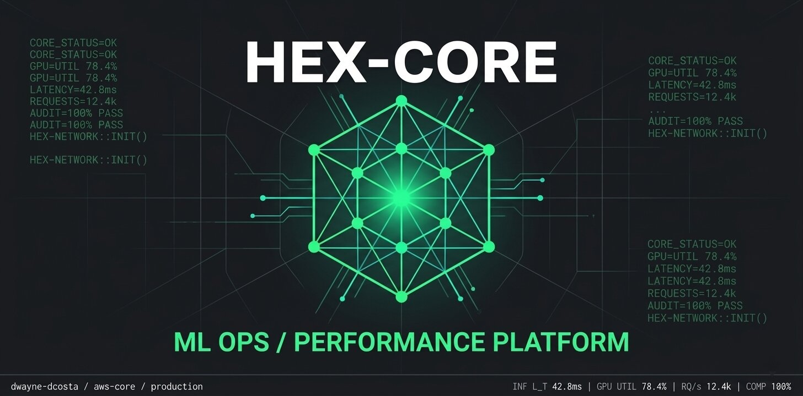

# MLOps & AI Governance Portfolio Platform

A production-grade, metrics-dense operational telemetry dashboard engineered to showcase system health, model linage, and deployment lifecycle streams for enterprise AI pipelines.

**Live Application:** [dwayne-dcosta-portfolio.vercel.app](https://dwayne-dcosta-portfolio.vercel.app/)

## 🛠️ Core Architecture & Stack
* **Frontend Core:** React 19, TypeScript, Tailwind CSS
* **Routing & State:** TanStack Start (File-based Routing framework)
* **Data Visualizations:** Recharts (High-performance streaming area and metric components)
* **Design Pattern:** shadcn/ui editorial console specification

## 📊 Dashboard Modules

### 1. System Health Engine
Simulates real-time infrastructure metrics across elastic computing clusters, tracking p95 inference latencies, compliance pass rates, and compute nodes customized to mimic real **AWS EC2 accelerated fleets** (P4de, P5, and Trainium instances).

### 2. Live Deployment Feed
Built as an automated activity logging pipeline designed to consume structured profile payloads. This section streams my professional timeline directly, showcasing milestones across:
* **AI Governance & Risk Mitigation:** ISO/IEC 42001 (AIMS) and EU AI Act alignment frameworks.
* **AWS Cloud Engineering:** Capstone structures from my completed **AWS Cloud Nanodegree**, highlighting automated infrastructure orchestration via CloudFormation templates, secure IAM boundary policies, and auto-scaled processing networks.

### 3. Model Registry Catalog
A fully versioned production model index mapping operational status tags (Stable, Inference, Canary, Staging) alongside key mathematical evaluation metrics for semantic vector databases, LLM guardrails, and physics-informed computational workflows.

---
*Maintained by Dwayne D'costa — AWS AI & ML Scholar '26*
